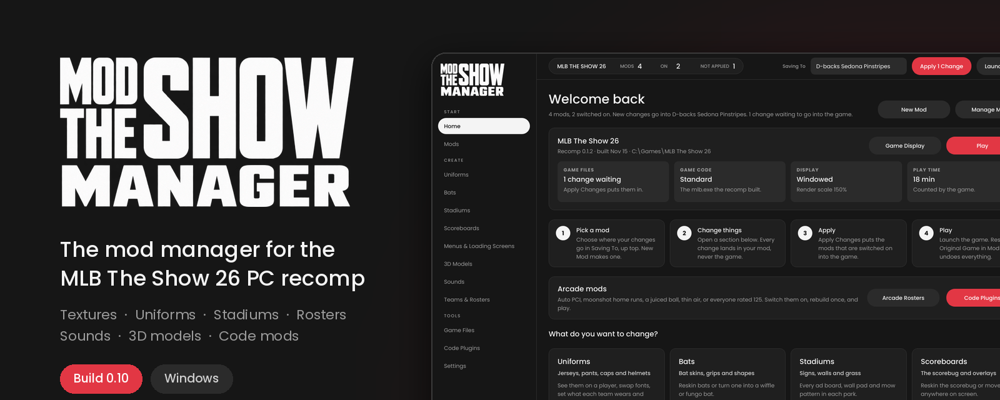
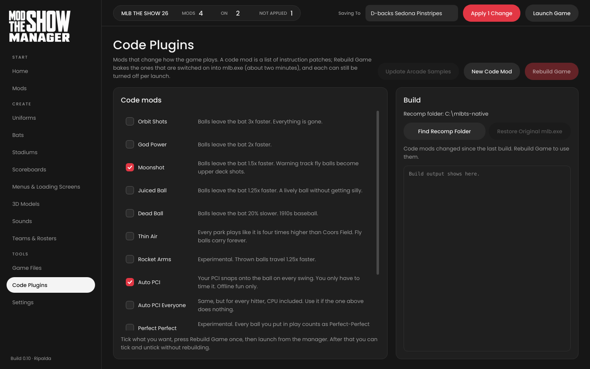
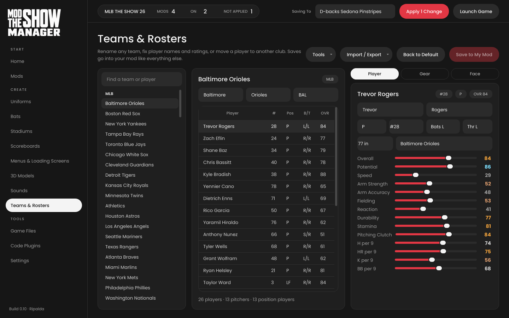
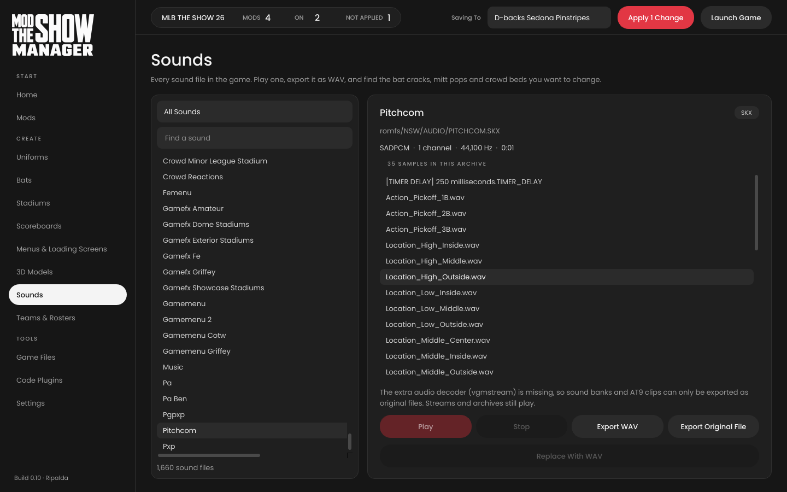
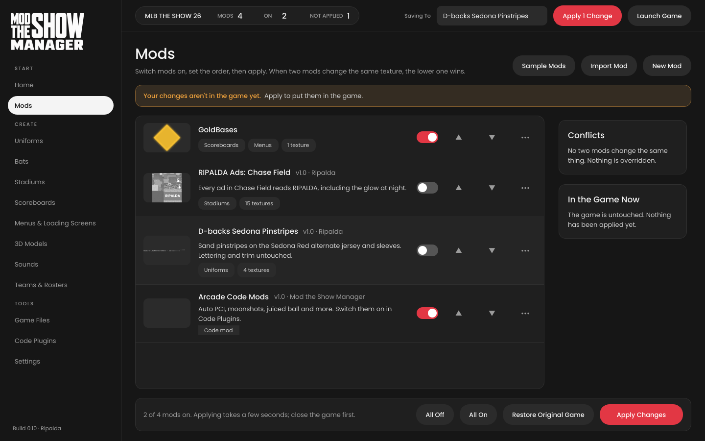

<p align="center"></p>

<p align="center">
  <a href="https://github.com/elripalda/ModTheShowManager/releases/latest"><b>Download</b></a> ·
  <a href="docs/QUICK_START.md">Quick start</a> ·
  <a href="docs/MODDING_GUIDE.md">Modding guide</a> ·
  <a href="docs/README.md">All docs</a>
</p>

<p align="center">
  <a href="https://recomplauncher.com"></a>
</p>

---

Mod the Show Manager opens up the MLB The Show 26 PC recomp. Browse every file in the game, swap textures,
edit rosters, move the scorebug, replace sounds and switch gameplay mods on and off, all from one app. Your
original files are never lost: everything a mod changes is backed up first and one button puts the game back.

## What it works with

This is for the **PC recomp of the Nintendo Switch version** of MLB The Show 26
([mlbts-native](https://github.com/sam110411/mlbts-native)). It doesn't work with the PS5 or Xbox game, and it
isn't an emulator tool: it reads and writes the files the recomp installs from your own Switch dump.

- Windows 10 or 11.
- The recomp installed and working. You can get it through [RecompLauncher](https://recomplauncher.com) or set
  it up yourself from the recomp's page. Either way you bring your own copy of the game.
- For code mods only: the recomp's own folder (the one `MLBTS-Setup.exe` is in), because the game has to be
  rebuilt. Code mods were made on game version 1.0.15; on any other version the manager checks each one and
  leaves out the ones that don't fit.

## Get it

Download `ModTheShowManager-Setup.exe` from [Releases](https://github.com/elripalda/ModTheShowManager/releases)
and run it. On first start it looks for
the game in `C:\Games\MLB The Show 26` and asks if it isn't there.

New here? The [quick start](docs/QUICK_START.md) gets a mod into the game in about five minutes.

## What you can do

| | |
| --- | --- |
| **Textures** | Uniforms, bats, stadium signs, scorebugs, menus and loading screens. Preview, export, drop your own PNG in, at up to 8x the size. |
| **Uniforms** | Build a look with colours, pinstripes and your own logo, and see it on a player with the cap, name and number. Set what each team wears and when. |
| **Stadiums** | Every ad board and wall in each park, plus a 3D view you can fly through. Click a sign to replace it. |
| **Scorebug** | See the scorebug drawn with its real art. Move it, flip its looks, tint, resize, hide or repaint any piece, change any text's font, size and colour, bring in your own fonts, play its animations and save the result as a style. Or build one from nothing: describe the pieces and the live data they show, and the manager compiles it for the game. Team colours follow the uniform worn, with your own colours per club and for City Connect. |
| **Packages** | One mod with a whole look: your scorebug, every ballpark's boards and the lineup and other broadcast screens in its colours. |
| **Stadium boards** | Every ballpark's scoreboards open in the same builder. Repaint a park by colour, or match all of them to your scorebug in one click. |
| **Teams & Rosters** | Edit names, ratings, numbers and gear, move players, auto-fill lineups. Hand a whole league aluminum bats or big heads. Import and export rosters as a [plain file](docs/ROSTER_FILES.md) you can write by hand or with an AI. |
| **Sounds** | Play and export every sound in the game, commentary included. Replace streams with your own WAV. |
| **3D Models** | View bats, balls, gear and props with their textures. Export OBJ, bring one back in. |
| **Code mods** | Gameplay changes built into the game, on one page and on F4 while you play: Auto PCI, and dials for exit velocity, pitch speed, pitch break, the air and how the ball bounces. |
| **Mods** | Each mod is a folder. Switch them on and off, set the order, apply. Restore puts the stock game back. |
| **Discover** | Mods other people have shared, one click to add. [Share your own](community/README.md). |
| **Launcher** | See what state the game is in and press Play. |

<p align="center">
  
  
</p>
<p align="center">
  
  
</p>

## Making a mod

1. Start editing. Changes are sorted into a mod per kind (My Uniforms, My Scoreboards…), or pick one mod in
   **Saving To** at the top.
2. Change something: replace a texture, edit a roster, move the scorebug.
3. Go to **Mods** and press **Apply**. Close the game first.

**Sample Mods** on the Mods page builds four ready-made ones from your own game files, one of each kind, if you
want something to switch on straight away.

A mod is a folder in `<game>\mods`, so it can be zipped and shared:

```
mods/My Mod/
  mod.json
  textures/NSW/STADIUMS/ARZ/TEXTURES_COLOR.TEX/rolling_sign_basecolor.png
  rosters/my league.json
  code/my code mod.patch
```

Share your own work, not the game's original files.

## Docs

| | |
| --- | --- |
| [Quick start](docs/QUICK_START.md) | Install, connect the game, first mod, undo everything. |
| [Modding guide](docs/MODDING_GUIDE.md) | Where everything lives in the game and how to find what you want. |
| [Designing your own scorebug](docs/SCOREBUG_DESIGN.md) | Build a scorebug in the sandbox or as a design file. |
| [Game data for a scorebug](docs/SCOREBUG_DATA.md) | The live values a piece can show. |
| [Making a scorebug with an AI](docs/SCOREBUG_AI.md) | What to paste into a chat AI so it writes a design for you. |
| [Roster files](docs/ROSTER_FILES.md) | The roster file format, with every rating and gear slot. |
| [Code mods](docs/CODE_MODS.md) | The list, the in-game menu, how to write your own, and the map of the gameplay code. |
| [Sharing mods](community/README.md) | What a shared mod can hold, league packs, and how to send yours in. |
| [What we've found](docs/DISCOVERIES.md) | How the game works inside: file formats, the audio codec, the databases, the code. |

## Building

```
pip install -r requirements.txt pyinstaller
python src/run.py                       # run from source
pyinstaller ModTheShowManager.spec      # build the exe
```

## Credits

Made by [Ripalda](https://www.elripalda.com). Runs on top of
[mlbts-native](https://github.com/sam110411/mlbts-native). Audio decoding for sound banks and ATRAC9 by
[vgmstream](https://vgmstream.org). Fonts: Poppins, Anton (SIL Open Font License).

Not affiliated with Sony Interactive Entertainment, San Diego Studio, MLB or Nintendo. Licensed under GPL-3.0.
