<p align="center"></p>

A mod manager for the MLB The Show 26 PC recomp. Browse every file in the game, preview any texture, export it,
drop in your own art and switch mods on and off.

## What it does

- **Game Files** – all 84,634 files in the game, searchable. Texture packs open as a grid you can preview,
  export or replace. Images and text files preview too.
- **Uniforms, Bats, Stadiums, Scoreboards, Menus & Loading Screens** – the same textures, sorted the way you think
  about them: by team and uniform, by ballpark, by scorebug theme.
- **Mods** – each mod is a folder in `<game>\mods`. Turn them on and off, set the order, Apply. Restore puts the
  original files back.
- **3D Models** – bats, balls, stadium props, players' gear, gloves, jerseys and bodies, drawn with their game
  textures. Export OBJ for Blender, bring an OBJ back in to replace a mesh on bats, balls and props, scale or
  hide meshes. Bat Shapes turns every bat in the game into a wiffle bat, a big barrel toy bat or a fungo.
- **Uniforms on a player** – flip the Uniforms page to *On a Player* and see the uniform you're editing on a
  mannequin with the cap, name and number, your replaced PNGs included.
- **Sounds** – every sound in the game plays and exports as WAV: crowd and reaction streams, sound banks, and
  the commentary, PA and music archives sample by sample. Streams can be replaced with your own WAV.
- **Scorebug layout** – move the scorebug and other overlays anywhere on screen.
- **Uniform schedule** – choose what each team wears and when, rename uniforms, hide them from the picker.
- **Teams & Rosters** – rename teams, edit players, ratings, numbers and gear, move players, swap face textures,
  and edit the custom team builder's names. Rosters export to and import from a plain
  [JSON file](docs/ROSTER_FILES.md), so a classic roster can be typed up (or written by an AI) and dropped in.
- **Code Plugins** – build instruction patches from mods into the game and switch them per launch. Comes with
  arcade samples: Auto PCI, moonshot home runs, a juiced ball, thin air. See [code mods](docs/CODE_MODS.md).
- **Launcher** – Home shows what state the game is in (stock or modded files, standard or code-mod build), has a
  Play button and the game's display settings.
- **Sample Mods** – four ready-made mods, built on your PC from your own game files, one of each kind.
- Dark, Light and OLED looks, text size, and an update check.
- **Stadiums in 3D** – orbit a ballpark or fly through it.
- Replaced textures keep the game's format: BC1, BC3, BC4 and BC7, with mip levels and loading previews rebuilt.

See the **[modding guide](docs/MODDING_GUIDE.md)** for where everything lives, how to find what you want and how
the file formats work.

## Get it

Download `ModTheShowManager-Setup.exe` from Releases and run it (or the plain `ModTheShowManager.exe` if you'd
rather not install). It looks for the game in `C:\Games\MLB The Show 26`
and asks if it isn't there.

## Making a mod

1. Pick the mod your changes go into from **Saving To** at the top (or make a new one).
2. Find a texture, export it, edit it, then **Replace With PNG** (or drop the PNG on the preview).
3. Go to **Mods** and press **Apply**. Close the game first.

A mod folder looks like this, so mods can be zipped and shared:

```
mods/My Mod/
  mod.json
  textures/NSW/STADIUMS/ARZ/TEXTURES_COLOR.TEX/rolling_sign_basecolor.png
  romfs/NSW/STADIUMS/ARZ/PROPS.XML
  romfs/NSW/OBJECTS/G4GAMEBAT.MOD        (models are two files:
  romfs/NSW/OBJECTS/G4GAMEBAT.0.MOD       the description and the geometry)
```

For a custom model, export the original OBJ first and build over it in Blender so the size and axes match,
then export with the same axis settings.

Share your own work, not the game's original files.

Nothing a mod does touches the originals for good. Apply copies each file it is about to change into
`<game>\mod-backup` first. Switch a mod off and Apply again and its files go back; **Restore Original Game** puts
everything back at once, the standard `mlb.exe` included.

## Building

```
pip install -r requirements.txt pyinstaller
python src/run.py                       # run from source
pyinstaller ModTheShowManager.spec      # build the exe
```

## Credits

Made by [Ripalda](https://www.elripalda.com). Runs on top of
[mlbts-native](https://github.com/sam110411/mlbts-native). Audio decoding by [vgmstream](https://vgmstream.org).
Fonts: Poppins, Anton (SIL Open Font License).

Licensed under GPL-3.0.
